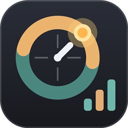

# ZoneQuanta

**中文** · [English](#english)

Windows桌面世界时钟 + 任务栏网速 / CPU / 内存监控 + 应用流量统计 + 快捷面板 + 浏览器新标签页。单个exe，自带运行时，不需要再安装任何东西。

**[下载最新版](https://github.com/Aevorine/ZoneQuanta-Releases/releases/latest)** · 觉得好用的话，点右上角的 ⭐ Star 支持一下。

## 功能

| | |
|---|---|
| 世界时钟 | 本地 + 任意城市（内置36个热门城市，可搜索系统全部时区），夏令时自动切换，24小时日轴按经纬度显示日出日落 |
| 任务栏监控条 | 上传 / 下载速度、今日流量、CPU、内存，悬停看详情与实时曲线 |
| 应用流量统计 | 按应用统计上传 / 下载，今天、本周、账期、一年等范围；每月额度与每日可用量 |
| 快捷面板 | 类似「开始」菜单的已固定：自动分组、文件夹、网站图标；搜索应用、文件（自带全盘索引）、设置、网页、算式，支持拼音与错字 |
| 电源 | 锁定 / 睡眠 / 休眠 / 重启 / 关机，定时计划与倒计时，电量触发，关机前自动保存文档 |
| 浏览器新标签页 | Chrome / Edge扩展：分组图标、文件夹、书签导入、四十个搜索引擎、图片 / 视频背景，可接自建同步服务，手机平板同一份数据 |
| 外观 | 四套低饱和护眼主题，动画可关；内存约75MB，空闲CPU通常在1%以内 |
| 在线更新 | 多线路并发下载，ECDSA签名与SHA-256双重校验 |

## 安装

在[Releases](https://github.com/Aevorine/ZoneQuanta-Releases/releases/latest)下载`ZoneQuanta.exe`，双击运行，首次运行选择安装位置。系统要求：Windows 10 / 11（x64）。

程序没有购买代码签名证书，SmartScreen可能提示「未知发布者」，点「更多信息 → 仍要运行」。每个版本的SHA-256写在该版本的`update.json`里，程序的「更新」页也会显示。

## 反馈

问题与建议请提到本仓库的[Issues](https://github.com/Aevorine/ZoneQuanta-Releases/issues)。

---

## English

A Windows desktop world clock with a taskbar monitor (network speed, CPU, memory), per-app traffic statistics with a monthly quota, a quick launcher with search (apps, files, settings, web), power actions with schedules, and a new-tab page for Chrome / Edge. One self-contained exe, nothing else to install.

**[Download the latest release](https://github.com/Aevorine/ZoneQuanta-Releases/releases/latest)** (Windows 10 / 11, x64). If you find it useful, a ⭐ is appreciated.

Updates are downloaded over several routes at once and verified twice (ECDSA signature and SHA-256). The program is not Authenticode-signed, so SmartScreen may show "unknown publisher".

This repository carries the releases and this page; issues are welcome here.
